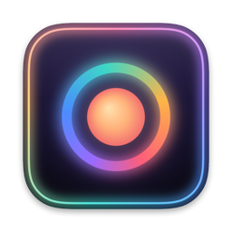
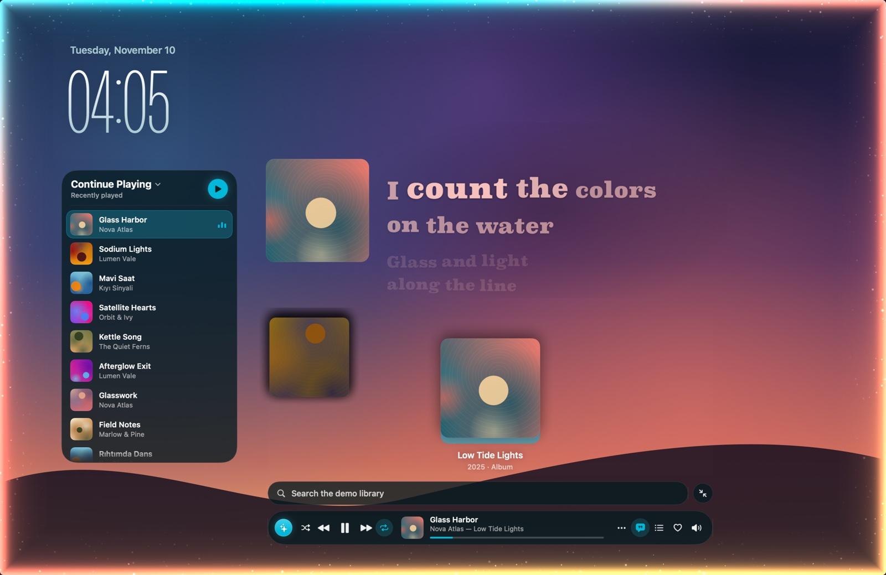
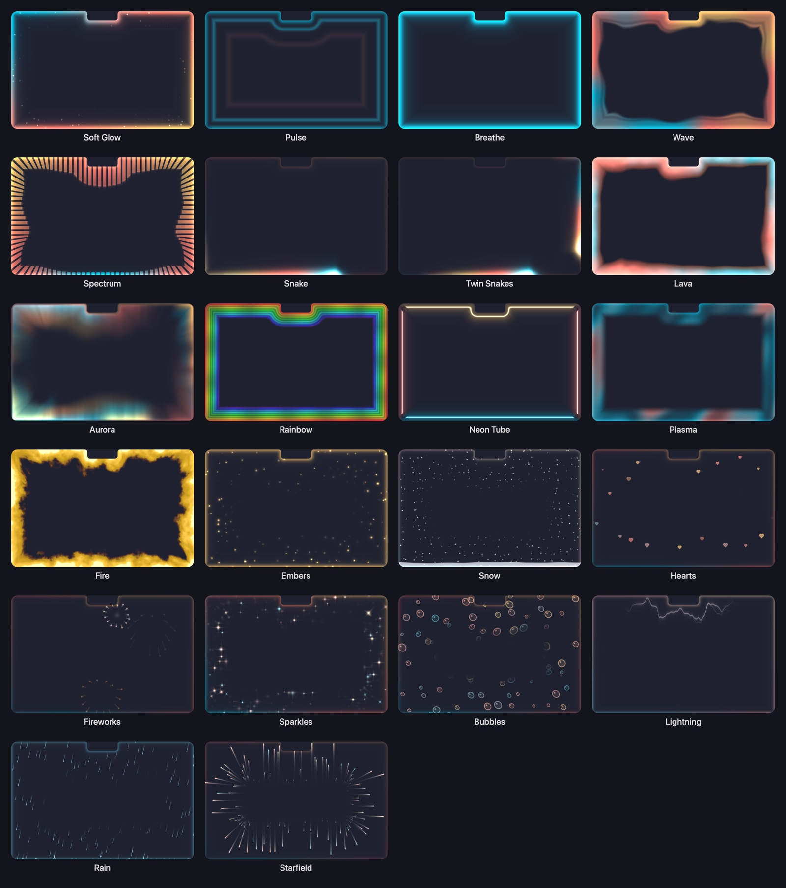
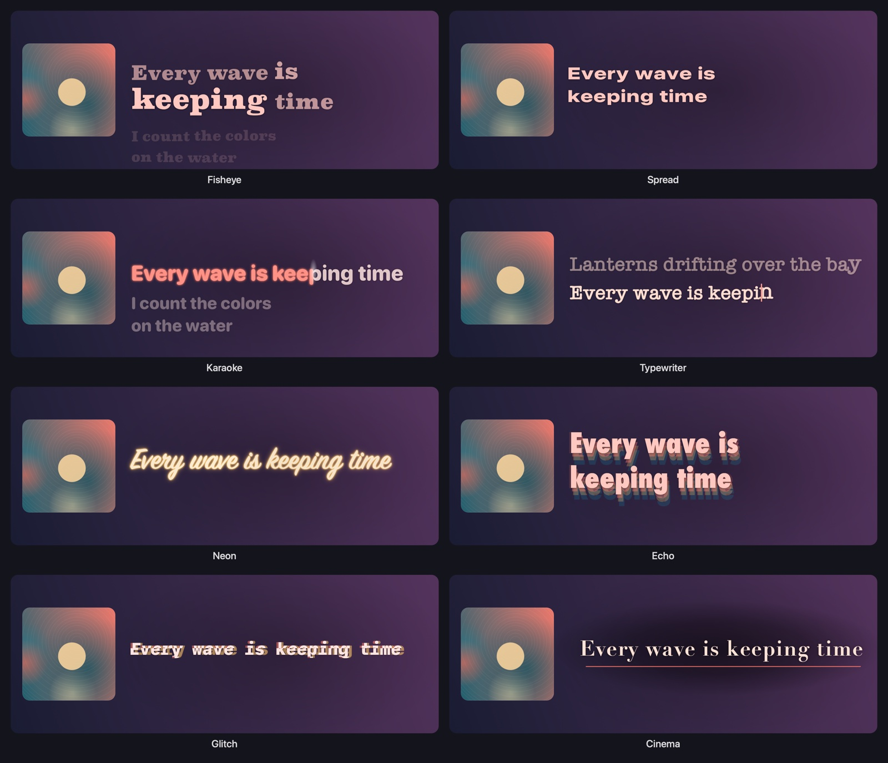
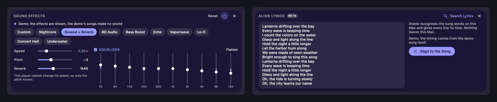
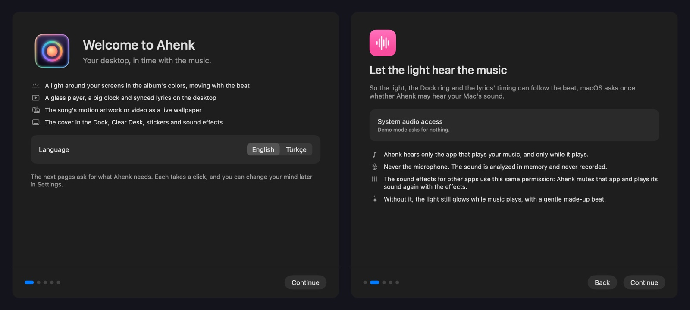
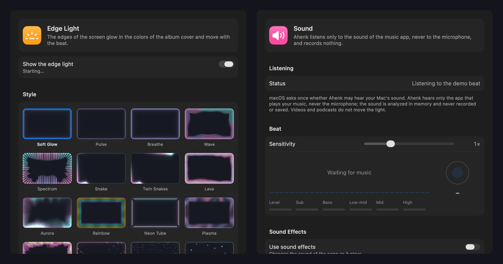
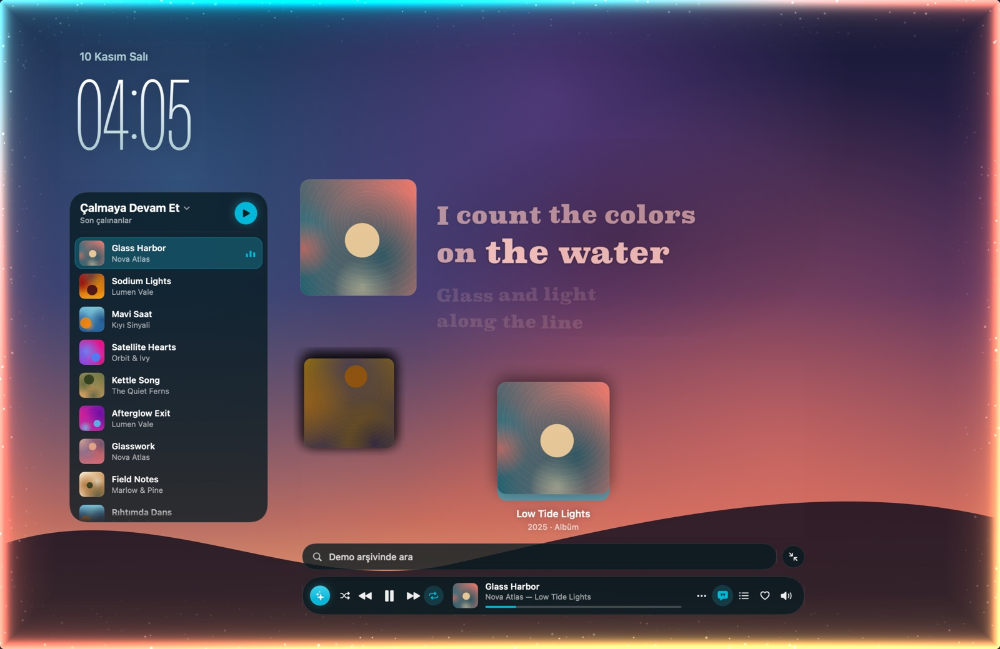

# Ahenk



**English** · [Türkçe](#türkçe)

Ahenk is a macOS app that makes the desktop move with the music: a light
around every screen in the album's colors that follows the beat, a glass
player and a big clock on the desktop, synced lyrics beside the cover, a live
wallpaper from the song's motion artwork or music video, and a Dock icon that
becomes the cover. It follows Apple Music, Spotify, music sites in the
browser, any app that shows what is playing, and your own song files.



<sub>Every picture here is drawn by Ahenk's demo mode: invented songs, invented lyric lines and generated covers.</sub>

## Features

- **Edge light.** The edges of every screen glow in the cover's colors and
  move with the beat: kicks push the light forward, calm parts let it drift.
  22 styles with live previews (Soft Glow, Pulse, Breathe, Wave, Spectrum,
  Snake, Twin Snakes, Lava, Aurora, Rainbow, Neon Tube, Plasma, Fire, Embers,
  Snow, Hearts, Fireworks, Sparkles, Bubbles, Lightning, Rain, Starfield); all
  edges, the bottom, the top or only the corners; thickness, glow, intensity,
  speed; the album's, your own or rainbow colors; on or off per display; "only
  on the desktop"; it steps aside for full-screen apps. When the music
  pauses it fades out and stops drawing.
- **Desktop player.** Under your windows: a big thin clock with the date,
  Continue Playing (playing row tinted), the playing artist's albums as a
  cover flow (click one for its songs; a pick plays the album on from there),
  a search field that plays the pick in the source you chose (right-click:
  Play Next, Add to Queue), and the player bar: shuffle, previous,
  play/pause, next, repeat, cover, title, "artist — album", progress, more,
  lyrics, queue, like and volume. The source picker at its left chooses
  where picks play and pauses the previous source; the list's title opens
  your playlists; one button plays or pauses the whole list; the queue panel
  shows what comes next (play, remove, add); a small player; a loading state
  while a song starts; "start every song at 0:15". When two sources play at
  once, the player and the menu bar menu ask which one to follow.
- **Lyrics.** Synced lyrics on the desktop beside the cover, in the cover's
  colors, in six styles with their own typefaces: Plain (nothing but
  the words), Glitch, Cinema, Karaoke, Typewriter and Drift. Instrumental parts show
  a music note that counts down to the next line. Other Lyrics, Search
  Lyrics, timing nudges kept per song, automatic sync, and the cover beside
  them can be hidden.
- **Lyrics timed on your Mac (Beta).** For a song with only plain words (or
  none: search for them or paste them), whisper.cpp hears the sung words on
  your Mac and Ahenk gives every line and word its time. A music video on
  YouTube or YouTube Music that runs apart from the album's recording (an
  intro) gets its lyrics moved into step the same way, by itself.
- **Live wallpaper.** While a song plays, the album's motion artwork (Apple's
  catalog), the song's music video or another one by the same artist
  (YouTube's embedded player, muted) or the moving cover melts in over your
  wallpaper and melts back when the music stops. The dots above the player
  choose the video; type the artist's name when it is not found. Keep your
  own videos (files or addresses) in a list and pick one.
- **Dock icon.** The cover with a ring that beats along and shows the song's
  progress; Ahenk's own icon comes back when nothing plays.
- **Clear Desk.** The moon button hides every other app with one click and
  brings exactly those back with another.
- **Stickers.** Pick any photo; its subject is cut out on your Mac and can be
  stuck on the desktop, the clock, the list, the player or the lyrics.
- **Your own songs.** Drop a folder of songs on Continue Playing and Ahenk
  plays it itself, with the light, lyrics, covers and wallpaper.
- **Sound effects.** Beside the lyrics: Nightcore, Slowed + Reverb, 8D
  Audio, Bass Boost, Echo, Vaporwave, Lo-fi, Concert Hall and Underwater,
  with speed, pitch, reverb and a ten-band equalizer, switched on and off
  while the song plays.
- **Light on your Mac.** Nothing playing means nothing drawn; anything
  hidden stops drawing; on battery and in Low Power Mode Ahenk runs lighter
  by itself.
- **English and Turkish**, switched in Settings › General whatever the Mac's
  language.







## Install

You need macOS 14.2 or later (Apple Silicon recommended) and Xcode 16 or
later (Swift 6).

```sh
git clone https://github.com/sinanmertsenerr/Ahenk.git
cd Ahenk
./Scripts/install.sh               # builds, signs and installs /Applications/Ahenk.app
open /Applications/Ahenk.app
```

The scripts sign with the maintainer's Apple Development identity when it is
on the Mac, so macOS keeps Ahenk's permissions across rebuilds. Anywhere else,
use `ALLOW_ADHOC=1 ./Scripts/install.sh`: the app is signed ad hoc and macOS
asks for its permissions again after each rebuild. `./Scripts/make-app.sh`
only builds `dist/Ahenk.app`.

The first launch opens a short guide: the permissions, the browser extension
and **Open Ahenk at login**. It opens again from the menu bar menu (**Getting
Started…**) and Settings › General, where opening at login can be switched
too. Ahenk lives in the menu bar (quick switches, Clear Desk, Settings) and
in the Dock, whose icon becomes the cover.

### Browser extension

Music sites in the browser (YouTube Music, YouTube, Spotify, SoundCloud,
Amazon Music, Deezer and TIDAL) report exactly what plays through the Ahenk
browser extension, and the desktop player plays your picks, playlists and
queue there. **Install Browser Extension…** in the menu bar menu shows its
folders in Finder (they are inside `Ahenk.app/Contents/Resources/Extension`):

- **Chrome, Edge, Brave, Arc, Opera, Vivaldi:** open the extensions page
  (`chrome://extensions`), turn on Developer mode, click **Load unpacked** and
  choose the `Chromium` folder. If you move Ahenk, load it again.
- **Search:** the puzzle button › **Load Unpacked…** › the `Chromium` folder.
- **Firefox:** `about:debugging` › This Firefox › **Load Temporary Add-on…** ›
  `manifest.json` in the `Firefox` folder. Firefox forgets it when it quits.

If you installed an earlier version, reload it on the extensions page: 1.2.0
is needed for the speed of Nightcore and Slowed in a browser tab. The
extension's button shows whether it is connected; Settings › Sources lists
the connected browsers, their music tabs and an extension that needs a reload.

## Permissions and privacy

Ahenk asks for two permissions, each only when you press its button (in the
guide or in Settings):

- **System audio** ("System Audio Recording Only"), so the light, the Dock
  ring and the lyrics' timing hear the beat. Ahenk listens to the app that
  plays your music, only while it plays, analyzes the sound in memory and
  records nothing; never the microphone. The sound effects for other apps
  use the same permission. If you said no: System Settings › Privacy &
  Security › Screen & System Audio Recording › System Audio Recording Only ›
  Ahenk. Without it the light still glows while music plays.
- **Automation** for Apple Music and Spotify, to read the song, its cover,
  shuffle, repeat and favorites and to send the commands you choose. macOS
  can ask only while that app is open. Without it Ahenk still shows what
  plays.

Optional: **signing in to Spotify** (Ahenk offers it when you pick Spotify
in the player; also Settings › Sources). Spotify brings itself to the front
when another app tells it to play a song. Signed in, Ahenk sends the song
the way Spotify's own remote does (like picking a song on your phone), and
Spotify stays in the background. You sign in on Spotify's own page; Ahenk
never sees your password, and the sign-in stays on this Mac until you press
Sign Out. This uses the web player's interface, not a published one: if
Spotify changes it, songs start the old way again.

What leaves your Mac: to find covers, albums and search results, a song's
title and artist (or what you type into the search) go to Apple's public
catalog, and Spotify's public page is asked for a track's cover; to play a
pick in Spotify, the song's title and artist are searched on Spotify's public
search page (and, if that cannot be read, sent to ListenBrainz) for its Spotify ID;
while lyrics are on, the playing song's title, artist, album and length go
to LRCLIB, Musixmatch and NetEase (each can be turned off in Settings ›
Lyrics); the live wallpaper searches YouTube and Apple's catalog for videos
by the song's title and artist and streams what it shows. The browser
extension talks only to Ahenk on this Mac (127.0.0.1, which accepts nothing
but the extension). Lyric alignment runs `whisper-cli`, which you install
yourself (`brew install whisper-cpp`), and a speech model that is fetched
only when you press **Download the Model**. Nothing else leaves your Mac.

## Demo mode

```sh
./Scripts/run-demo.sh              # invented songs, generated covers, a 120 BPM beat; no music or permissions
```

The demo runs every feature without touching your music. The pictures in
this README come from `./Scripts/make-screenshots.sh`, which draws Ahenk's
own views offscreen in demo mode; nothing of the screen is captured.





## Performance

Measured on an M5 MacBook Pro (release build, demo mode, one 1512 × 982
display, CPU of Ahenk's own process averaged over 30 s with `top`):

| Situation | CPU | Memory |
|---|---|---|
| Nothing playing (live) | 0.0 % | 44 MB |
| Paused (demo) | 0.0 % | 96 MB |
| Playing: light, player, lyrics and Dock icon | 8.7 % | 169 MB |
| The same with the live wallpaper | 9.1 % | 168 MB |
| On battery (lighter by itself) | 6.4 % | 153 MB |
| Low Power Mode | 5.5 % | 151 MB |

## Development

```sh
./Scripts/make-app.sh              # build and sign dist/Ahenk.app
./Scripts/test.sh                  # lint, the extension's tests and the unit tests
./Scripts/smoke.sh                 # every subsystem, headless (also checks both languages)
./Scripts/bridge-e2e.sh            # the browser extension end to end in a headless test browser
./Scripts/make-screenshots.sh      # the README's pictures
```

`docs/PROGRESS.md` describes how each part works, what was measured and
what is known not to work yet.

## License

MIT. See [LICENSE](LICENSE) and [THIRD_PARTY_NOTICES.md](THIRD_PARTY_NOTICES.md).

---

## Türkçe

Ahenk, masaüstünü müzikle birlikte hareket ettiren bir macOS uygulamasıdır:
her ekranın çevresinde albümün renkleriyle ritmi izleyen bir ışık,
masaüstünde cam bir oynatıcı ve büyük bir saat, kapağın yanında eşzamanlı
şarkı sözleri, şarkının hareketli kapağından ya da müzik videosundan canlı
duvar kâğıdı ve albüm kapağına dönüşen bir Dock simgesi. Apple Music'i,
Spotify'ı, tarayıcıdaki müzik sitelerini, çalan şarkıyı gösteren her
uygulamayı ve kendi şarkı dosyalarınızı izler.



<sub>Buradaki bütün görseller Ahenk'in demo modunda çizildi: kurgusal şarkılar, kurgusal söz satırları ve üretilmiş kapaklar.</sub>

## Özellikler

- **Kenar ışığı.** Her ekranın kenarları kapağın renkleriyle parlar ve
  ritimle hareket eder: vuruşlar ışığı öne iter, sakin bölümlerde ışık
  süzülür. Canlı önizlemeli 22 stil (Yumuşak Işıma, Nabız, Nefes, Dalga,
  Spektrum, Yılan, İkiz Yılanlar, Lav, Kutup Işıkları, Gökkuşağı, Neon Tüp,
  Plazma, Ateş, Korlar, Kar, Kalpler, Havai Fişek, Pırıltılar, Baloncuklar,
  Şimşek, Yağmur, Yıldızlar); bütün kenarlar, yalnızca alt, yalnızca üst
  ya da yalnızca köşeler; kalınlık, parlama, yoğunluk, hız; albümün renkleri,
  kendi renkleriniz ya da gökkuşağı; ekran başına açma kapama; "yalnızca
  masaüstünde" modu; tam ekran uygulamalarda kenara çekilir. Müzik
  duraklayınca yavaşça söner ve çizmeyi tamamen bırakır.
- **Masaüstü oynatıcı.** Pencerelerinizin altında: tarihiyle birlikte büyük
  ve ince bir saat, Çalmaya Devam Et listesi (çalan satır renkli), çalan
  sanatçının albümlerini dizen kapak akışı (bir albüme tıklayınca şarkıları
  açılır, seçtiğiniz şarkıdan sonra albüm oradan devam eder), seçtiğiniz
  kaynakta çalan bir arama alanı (sağ tık: Hemen Sonra Çal, Çalma Sırasına
  Ekle) ve
  oynatıcı çubuğu: karıştır, önceki, çal/duraklat, sonraki, tekrar, kapak,
  şarkı adı, "sanatçı — albüm", ilerleme, diğer, sözler, sıra, beğen ve ses.
  Çubuğun solundaki kaynak seçici şarkıların nerede çalacağını belirler ve
  önceki kaynağı duraklatır; listenin başlığı çalma listelerinizi açar; tek
  düğme bütün listeyi çalar ya da duraklatır; sıra paneli sırada ne olduğunu
  gösterir (çal, çıkar, ekle); küçük oynatıcı; şarkı başlarken bir yükleniyor
  görünümü; "her şarkıyı 0:15'ten başlat". İki kaynak aynı anda çalarsa
  oynatıcı ve menü çubuğu menüsü hangisinin izleneceğini sorar.
- **Şarkı sözleri.** Masaüstünde, kapağın yanında, kapağın renkleriyle ve
  her biri kendi yazı tipiyle altı stilde eşzamanlı sözler: Sade (yalnızca
  sözler), Bozulma, Sinema, Karaoke, Daktilo ve Süzülme. Enstrümantal
  bölümlerde bir müzik notası sonraki satıra geri sayar. Diğer Sözler, Söz
  Ara, şarkı başına saklanan zamanlama ayarı, otomatik eşitleme; sözlerin
  yanındaki kapak gizlenebilir.
- **Mac'inizde zamanlanan sözler (Beta).** Yalnızca zamansız sözleri olan
  (ya da hiç sözü olmayan: arayıp bulun veya yapıştırın) bir şarkıda
  whisper.cpp söylenen sözleri Mac'inizde duyar, Ahenk de her satıra ve
  sözcüğe zamanını verir. YouTube veya YouTube Music'teki bir müzik videosu
  albüm kaydından farklı ilerliyorsa (örneğin başında bir giriş sahnesi
  varsa) Ahenk sözleri aynı yolla kendiliğinden videoya göre kaydırır.
- **Canlı duvar kâğıdı.** Şarkı çalarken albümün hareketli kapağı (Apple'ın
  kataloğundan), şarkının müzik videosu ya da aynı sanatçının başka bir
  videosu (YouTube'un yerleştirilmiş oynatıcısında, sessiz) veya hareket eden
  kapak duvar kâğıdınızın üzerine yavaşça gelir, müzik durunca yavaşça geri
  çekilir. Videoyu oynatıcının üstündeki noktalar seçer; sanatçı
  bulunamazsa adını yazarsınız. Kendi videolarınızı (dosya ya da adres) bir
  listede tutup birini seçebilirsiniz.
- **Dock simgesi.** Ritimle atan ve şarkının ilerleyişini gösteren bir
  halkayla birlikte albüm kapağı; hiçbir şey çalmadığında Ahenk'in kendi
  simgesi geri gelir.
- **Masayı Temizle.** Ay düğmesi tek tıkla diğer bütün uygulamaları gizler,
  ikinci tıkla tam olarak onları geri getirir.
- **Çıkartmalar.** Herhangi bir fotoğrafı seçin; öznesi Mac'inizde kesilir ve
  masaüstüne, saate, listeye, oynatıcıya ya da sözlere yapıştırılabilir.
- **Kendi şarkılarınız.** Bir şarkı klasörünü Çalmaya Devam Et listesine
  bırakın; Ahenk onu ışık, sözler, kapaklar ve duvar kâğıdıyla birlikte
  kendisi çalar.
- **Ses efektleri.** Sözlerin yanında: Nightcore, Slowed + Reverb, 8D Ses,
  Bas Güçlendirme, Yankı, Vaporwave, Lo-fi, Konser Salonu ve Su Altı; hız,
  perde, yankılanma ve on bantlı ekolayzırla birlikte, şarkı çalarken açılıp
  kapanır.
- **Mac'inizi yormaz.** Hiçbir şey çalmıyorsa hiçbir şey çizilmez; görünmeyen
  her parça çizmeyi bırakır; pilde ve Düşük Güç Modunda Ahenk kendiliğinden
  daha hafif çalışır.
- **İngilizce ve Türkçe**: Mac'in dili ne olursa olsun Ayarlar › Genel'den
  seçilir.


## Kurulum

macOS 14.2 ya da sonrası (Apple Silicon önerilir) ve Xcode 16 ya da sonrası
(Swift 6) gerekir.

```sh
git clone https://github.com/sinanmertsenerr/Ahenk.git
cd Ahenk
./Scripts/install.sh               # derler, imzalar ve /Applications/Ahenk.app olarak kurar
open /Applications/Ahenk.app
```

Betikler, Mac'te varsa geliştiricinin Apple Development kimliğiyle imzalar;
böylece macOS, Ahenk'in izinlerini yeniden derlemelerden sonra da hatırlar.
Başka bir Mac'te `ALLOW_ADHOC=1 ./Scripts/install.sh` kullanın: uygulama
geçici imzayla imzalanır ve macOS her derlemeden sonra izinleri yeniden
sorar. `./Scripts/make-app.sh` yalnızca `dist/Ahenk.app` paketini derler.

İlk açılışta kısa bir rehber açılır: izinler, tarayıcı eklentisi ve
**Oturum açıldığında Ahenk'i aç** seçeneği. Rehber menü çubuğu menüsünden
(**Başlangıç Rehberi…**) ve Ayarlar › Genel bölümünden yeniden açılır;
oturum açılışında başlatma da orada açılıp kapatılır. Ahenk menü çubuğunda
(hızlı anahtarlar, Masayı Temizle, Ayarlar) ve simgesi albüm kapağına dönüşen
Dock'ta yaşar.

### Tarayıcı eklentisi

Tarayıcıdaki müzik siteleri (YouTube Music, YouTube, Spotify, SoundCloud,
Amazon Music, Deezer ve TIDAL), Ahenk tarayıcı eklentisi sayesinde neyin
çaldığını tam olarak bildirir; masaüstü oynatıcı da seçtiğiniz şarkıları,
çalma listelerini ve çalma sırasını orada çalar. Menü çubuğu menüsündeki
**Tarayıcı Eklentisini Kur…** komutu eklentinin klasörlerini Finder'da
gösterir (klasörler `Ahenk.app/Contents/Resources/Extension` içindedir):

- **Chrome, Edge, Brave, Arc, Opera, Vivaldi:** uzantılar sayfasını açın
  (`chrome://extensions`), Geliştirici modunu açın, **Paketlenmemiş öğe
  yükle** düğmesine tıklayın ve `Chromium` klasörünü seçin. Ahenk'i başka bir
  yere taşırsanız klasörü yeniden yükleyin.
- **Search:** yapboz düğmesi › **Load Unpacked…** › `Chromium` klasörü.
- **Firefox:** `about:debugging` › Bu Firefox › **Geçici Eklenti Yükle…** ›
  `Firefox` klasöründeki `manifest.json`. Firefox kapanınca eklentiyi unutur.

Daha önceki bir sürümü kurduysanız uzantılar sayfasından yeniden yükleyin:
bir tarayıcı sekmesinde Nightcore ve Slowed hızının değişmesi için 1.2.0
sürümü gerekir. Eklentinin düğmesi bağlı olup olmadığını gösterir; Ayarlar ›
Kaynaklar bölümü bağlı tarayıcıları, müzik sekmelerini ve yeniden yüklenmesi
gereken bir eklentiyi listeler.

## İzinler ve gizlilik

Ahenk iki izin ister; her birini yalnızca ilgili düğmeye bastığınızda
(rehberde ya da Ayarlar'da) sorar:

- **Sistem sesi** ("Yalnızca Sistem Sesi Kaydı"): ışık, Dock'taki halka ve
  sözlerin zamanlaması ritmi duysun diye. Ahenk müziğinizi çalan uygulamayı
  yalnızca o çalarken dinler, sesi bellekte analiz eder ve hiçbir şey
  kaydetmez; mikrofon asla kullanılmaz. Başka uygulamalardaki ses efektleri
  de aynı izni kullanır. Hayır dediyseniz: Sistem Ayarları › Gizlilik ve
  Güvenlik › Ekran ve Sistem Sesi Kaydı › Yalnızca Sistem Sesi Kaydı ›
  Ahenk. Bu izin olmadan da ışık müzik çalarken parlar.
- **Otomasyon**: Apple Music ve Spotify'dan şarkıyı, kapağını, karıştırma,
  tekrar ve favori bilgisini okumak ve seçtiğiniz komutları göndermek için.
  macOS bunu yalnızca o uygulama açıkken sorabilir. Bu izin olmadan da Ahenk
  neyin çaldığını gösterir.

Mac'inizden çıkanlar: kapakları, albümleri ve arama sonuçlarını bulmak için
şarkının adı ve sanatçısı (ya da aramaya yazdıklarınız) Apple'ın herkese açık
kataloğuna gider, bir parçanın kapağı Spotify'ın herkese açık sayfasından
istenir; seçtiğiniz bir şarkıyı Spotify'da çalmak için şarkının adı ve
sanatçısı Spotify'ın herkese açık arama sayfasında aranır (sayfa okunamazsa
ListenBrainz'e sorulur) ve Spotify kimliği oradan alınır; sözler açıkken çalan şarkının
adı, sanatçısı, albümü ve süresi LRCLIB, Musixmatch ve NetEase hizmetlerine
gider (her biri Ayarlar › Şarkı Sözleri bölümünden kapatılabilir); canlı
duvar kâğıdı videoları şarkının adı ve sanatçısıyla YouTube'da ve Apple'ın
kataloğunda arar, gösterdiğini akış olarak oynatır. Tarayıcı eklentisi
yalnızca bu Mac'teki Ahenk'le konuşur (127.0.0.1; Ahenk eklentiden başkasını
kabul etmez). Sözleri hizalamak için kendi kurduğunuz `whisper-cli` (`brew
install whisper-cpp`) çalışır; konuşma modeli yalnızca **Modeli İndir**
düğmesine bastığınızda indirilir. Mac'inizden başka hiçbir şey çıkmaz.

## Demo modu

```sh
./Scripts/run-demo.sh              # kurgusal şarkılar, üretilmiş kapaklar, dakikada 120 vuruş; müzik ya da izin gerekmez
```

Demo, müziğinize dokunmadan bütün özellikleri çalıştırır. Bu sayfadaki
görseller, Ahenk'in kendi görünümlerini demo modunda ekran dışında çizen
`./Scripts/make-screenshots.sh` betiğinden gelir; ekrandan hiçbir şey
yakalanmaz.


## Performans

M5 işlemcili bir MacBook Pro'da ölçüldü (sürüm derlemesi, demo modu, tek bir
1512 × 982 ekran; Ahenk'in kendi sürecinin işlemci kullanımı, `top` ile 30
saniyelik ortalama):

| Durum | İşlemci | Bellek |
|---|---|---|
| Hiçbir şey çalmıyor (gerçek kullanım) | %0,0 | 44 MB |
| Duraklatıldı (demo) | %0,0 | 96 MB |
| Çalıyor: ışık, oynatıcı, sözler ve Dock simgesi | %8,7 | 169 MB |
| Aynısı, canlı duvar kâğıdıyla | %9,1 | 168 MB |
| Pilde (kendiliğinden hafif) | %6,4 | 153 MB |
| Düşük Güç Modu | %5,5 | 151 MB |

## Geliştirme

```sh
./Scripts/make-app.sh              # dist/Ahenk.app paketini derler ve imzalar
./Scripts/test.sh                  # denetimler, eklentinin testleri ve birim testleri
./Scripts/smoke.sh                 # bütün alt sistemleri arayüzsüz dener (iki dili de denetler)
./Scripts/bridge-e2e.sh            # tarayıcı eklentisini arayüzsüz bir test tarayıcısında baştan sona dener
./Scripts/make-screenshots.sh      # bu sayfadaki görseller
```

`docs/PROGRESS.md` her parçanın nasıl çalıştığını, neyin ölçüldüğünü ve
neyin henüz çalışmadığını anlatır.

## Lisans

MIT. Ayrıntılar [LICENSE](LICENSE) ve
[THIRD_PARTY_NOTICES.md](THIRD_PARTY_NOTICES.md) dosyalarında.
